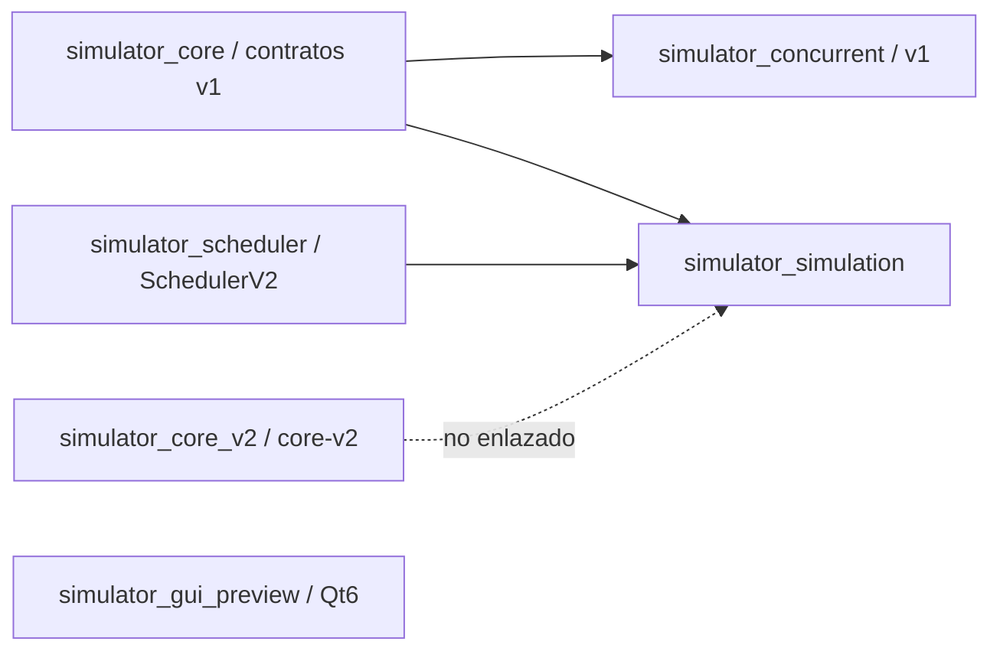

# Auditoría y matriz de integración v2

**Corte remoto:** 2026-10-15, después de `git fetch --all --prune`.

**Línea base:** `origin/master` = `952c1f39b1aca418ef5616b3f230a9d780c89911`.
**Alcance:** auditoría de ramas y PRs; preparación de dependencias y gates. Este documento no declara módulos v2 integrados ni adopta propuestas técnicas.

## Estado Git y PRs

| Espacio | HEAD observado | Relación con `origin/master` | PR al corte | Estado verificable |
|---|---|---|---|---|
| `master` | `952c1f3` | línea base | — | Contratos v1 vigentes; contratos v2 candidatos; DP-01–DP-11 formalizadas. |
| `castilla` | `d9d1c49` | 11 commits propios sobre `master` | [#5](https://github.com/mrcastilla8/task-manager-demo/pull/5), Draft, base `master` | Core v2 aislado en `core/v2`; sin cambios a v1 ni `contracts/`. Incluye modelo, lista simple, memoria, admisión y pruebas. La descripción del PR informa MSVC Debug y CTest 8/8 PASS; esta matriz registra esa declaración, no una ejecución independiente. |
| `brickzon` | `08cc15f` | 7 commits propios; base común `master` | No hay PR | Scheduler v2 y suite existen. HEAD retiró la lista provisional y documenta overflow; sigue teniendo API que clasifica vistas además de elegir READY. |
| `aldana` | `e9dd9ab` | 3 commits de trabajo desde `a5b1062`, anterior a `master`; incluye historia documental compartida | No hay PR | Motor lógico v2 existe, pero mantiene procesos, memoria y tickets propios en vectores; el Scheduler copiado es anterior a `brickzon` HEAD. No consume `ListaProcesos` ni `Memoria` oficiales. |
| `angel` | `4d5b14a` | 13 commits propios más sincronizaciones; base común `master` | [#3](https://github.com/mrcastilla8/task-manager-demo/pull/3), abierto, base `master` | Motor concurrente de la línea v1: incluye `contracts/*.h`, `ColaProcesos`, `Memoria`, quantum global y aging. No consume Scheduler/Core v2. El cuerpo del PR está vacío; no se atribuye un resultado de pruebas. |
| `poma` | `976654b` | 6 commits propios más sincronizaciones; base común `master` | [#6](https://github.com/mrcastilla8/task-manager-demo/pull/6), Draft, base `master` | Prototipo Qt 6 con fixtures/adaptadores; sin fábrica ni motor real. El PR informa CTest 5/5 sin Qt y 7/7 con Qt; Qt 6.8.3, MinGW 13.1.0, CMake 4.4.4. Declaración del PR, no CI. |

Al iniciar la auditoría, `fetch` avanzó `brickzon` de `f8a9619` a `08cc15f`, `aldana` de `03a89d3` a `e9dd9ab`, `poma` de `9f6bdb2` a `976654b` y `angel` de `9ce6e32` a `4d5b14a`. `master` (`952c1f3`) y `castilla` (`d9d1c49`) no cambiaron durante la consulta.

Los PRs #1, #2 y #4 están fusionados. La consulta completa de PRs no encontró PR para Brickzon ni Aldana; sí encontró el #3 de Ángel, además de #5 y #6. No hay workflows en `.github/workflows` en `master`, por lo que no se declara CI PASS. Los SHA son del corte de auditoría, no referencias para forzar ramas.

### Commits y archivos por rama

| Rama | Commits de trabajo del corte (orden cronológico aproximado) | Archivos principales modificados |
|---|---|---|
| Castilla | `643ce83`, `108b2a0`, `b79333d`, `7338dc6`, `77cc08e`, `19a9f7a`, `e317ebb`, `e85593d`, `0920388`, `cc0ce4a`, `d9d1c49` | `core/v2/{Proceso,ListaProcesos,Memoria,AdmisorProcesos}.{h,cpp}`, `core/v2/README.md`, `tests/test_v2_*.cpp`, `tests/CMakeLists.txt`, `CMakeLists.txt`. |
| Brickzon | `5a721c2`, `b2e991e`, `f8a9619`, `fb7e722`, `4a68543`, `f6a549e`, `08cc15f` | `scheduler/Scheduler*`, pruebas `tests/test_scheduler*`, `tests/FixturesV2.h`, CMake y `.gitignore`. |
| Aldana | `9211133`, `9cac87c`, `e9dd9ab` (merge base `a5b1062`; su historia también contiene documentación/contratos v2 compartidos antes de la línea base actual) | `simulation/Simulation*V2.*`, copia de `scheduler/SchedulerV2.*`, `tests/test_simulation*`, CMake; además documentación y contratos compartidos en la historia divergente. |
| Ángel | `dd0dd15`, `5a721c2`, `b2e991e`, `61509f2`, `632a94e`, `eca2a6a`, `9ce6e32`, `7771a9e`, `10123ff`, `9c42208`, `82cfd2a`, `5730ded`, `4d5b14a` | `concurrent/{ConcurrentEngine,ProcessThread,Synchronization}.*`, copia de Scheduler v1, `tests/test_concurrent*`, `tests/SnapshotInvariants.h`, CMake y trazabilidad/README. |
| Poma | `60b0225`, `1b6174b`, `8f43897`, `cd3af98`, `aca961d`, `976654b` | `gui/*`, `main.cpp`, `scripts/run-gui-preview.ps1`, CMake, tests GUI y README/trazabilidad. |

### Validación ejecutada durante esta auditoría

En el checkout del usuario `castilla` (`d9d1c49f5887428e81ad939487104df73ca88745`), Windows `10.0.26200.0`, MSVC `19.29.30159.0` y CMake `4.4.3`:

```text
cmake -S . -B build-integracion -DBUILD_TESTING=ON -DSIMULATOR_WARNINGS_AS_ERRORS=ON -DSIMULATOR_BUILD_GUI_PREVIEW=OFF
cmake --build build-integracion --config Debug --parallel 2
ctest --test-dir build-integracion -C Debug --output-on-failure -j 2
```

Configuración y build finalizaron correctamente; CTest dio **8/8 PASS** (4 pruebas v1 y 4 pruebas Core v2), total 0.85 s observado. CMake avisó que `SIMULATOR_BUILD_GUI_PREVIEW` no se usa en esta rama. `git diff --check` pasó en el checkout evaluado. Esto valida únicamente `castilla` aislada; no ejecuta Scheduler, Aldana, Ángel, GUI ni CI.

## Matriz de dependencias por pares

| Relación | Interfaz y estado observado | Prueba / evidencia disponible | Gate pendiente |
|---|---|---|---|
| Castilla–Brickzon | `ListaProcesos::obtenerTodos()` entrega una copia `vector<Proceso>` y tiene setters individuales. `Scheduler` clasifica vectores y listas, pero `ListaProcesos::reclasificarPrioridades()` conserva un algoritmo propio. No existe aplicación validada del lote del Scheduler a la lista. | Suites aisladas declaradas en PR #5; Scheduler tiene suites en `brickzon`, sin resultado remoto reportado. | Una sola clasificación en Scheduler; API de lote que valide todos los PID/valores antes de mutar; rechazo atómico. Incorporar Scheduler después de Core en un PR apilado. |
| Castilla–Aldana | El motor lógico crea su propio `vector<Proceso>` y contador de memoria; CMake lo enlaza a `simulator_core` v1, no `simulator_core_v2`. | Tests `test_simulation_*` existen en `aldana`; sin resultado reproducible en PR porque no hay PR. | Reemplazar almacenamiento y admisión propios por Core v2, conservando snapshots/historial y rollback; reclasificar vía Scheduler único. Depende de G1 y del gate Core/Scheduler. |
| Brickzon–Aldana | Aldana incluye una copia de `SchedulerV2`; CMake la compila como `simulator_scheduler`. Los motores llaman su clasificador/selector, pero el código de motor maneja sus propios tickets y estado. | CMake de `aldana` registra pruebas de Scheduler y motor en una suite; los archivos no prueban equivalencia con Core oficial. | El motor debe depender de la biblioteca Scheduler compartida y del asignador común; añadir pruebas de clasificación persistida y traza Core–Scheduler–motor. |
| Aldana–Poma | `EngineSession` y vistas del prototipo aceptan snapshots/adaptadores, pero no hay fábrica concreta ni target que enlace `simulator_simulation`. | El PR #6 reporta suites visuales puras y Qt offscreen; sus casos usan fixtures/mock y no simulan motor real. | Mantener preview identificado; conectar después de ratificar la API, driver, eventos y publicar snapshots reales. GUI debe seguir fuera de la política. |
| Core/Scheduler–Ángel | `ConcurrentEngine` usa contratos raíz v1, `ColaProcesos`, `Memoria` y su `Scheduler` v1. Su branch contiene headers Scheduler v1 propios; no referencia `core/v2` ni `SchedulerV2`. | Tests concurrentes existen en `angel`; el PR #3 no declara ejecución. | Migración posterior a API/Core/Scheduler v2 y pruebas repetidas de carreras y trazas equivalentes. Cancelación RUN, checkpoints y orden de frontera requieren G1. |

## Grafo CMake auditado



La relación CMake de Aldana es unidireccional (`simulator_simulation` enlaza Core v1 y Scheduler); no se observa dependencia circular de targets. La incoherencia es de integración/propiedad de datos: el motor guarda otra fuente de procesos y memoria, y `ListaProcesos` y `Scheduler` duplican el clasificador. Ángel permanece separado en v1. La GUI se construye como preview opcional que depende de Qt 6 y no enlaza motor ni Core. CMake no demuestra que las semánticas sean comunes.

## Hallazgos técnicos y correcciones requeridas

1. **Clasificación duplicada.** `core/v2/Proceso.cpp` define `clasificarPrioridades`; `ListaProcesos::reclasificarPrioridades()` la invoca. `SchedulerV2` implementa también `evaluarPrioridad` y `clasificarPrioridades`. La autoridad acordada para cálculo es Scheduler; Core almacena/valida. Cambiarlo exige un flujo de vista → cálculo → lote validado → aplicación sin mutación parcial. No hacer que Core enlace Scheduler ni introducir dependencia circular. Revisar la API de lote con Castilla y Brickzon antes del cambio.
2. **Dos fuentes de verdad en Aldana.** `SimulationEngineV2` guarda `procesos_`, `memoriaUsadaBytes_`, esperas y `siguienteTicket_`; no usa `ListaProcesos`, `Memoria` ni `AsignadorTickets`. Su función de clasificación delega en Scheduler, pero su lista de procesos es independiente de Core. El target CMake enlaza la implementación v1 de Core. No declarar Core–Aldana integrado.
3. **Política de overflow discordante.** `AsignadorTickets` de Brickzon falla explícitamente sin wrap; `SimulationEngineV2::asignarTicket()` en Aldana renumera READY establemente en el agotamiento. La alternativa de error/renumeración está pendiente (Propuesta 11). Conservar defensa contra wrap, bloquear el comportamiento integrado hasta ratificación.
4. **Turno continuo y cancelación.** `iniciar()` lógico solo cambia estado; no existe operación para avanzar una unidad en EJECUTANDO. `cancelarProceso()` lógico no observa RUN durante la llamada síncrona. En Ángel la ráfaga se calcula como unidad completa; su retardo físico de coordinación no es un checkpoint lógico. No agregar checkpoints de 1 ms ni esperas físicas para representar CPU.
5. **Eventos y publicación.** `Evento` no tiene secuencia ni fija semántica de timestamp de CPU; la GUI requiere snapshots y eventos ordenados para replay RUN. La publicación atómica de cambios de prioridad, eventos y snapshot está propuesta, no ratificada. No inventar secuencias/timestamps contractuales.
6. **READY y WAIT simultáneo.** Scheduler lanza si READY carece de ticket (buena detección defensiva). Core tiene setter individual que no baja ticket. Aldana asigna tickets en un contador privado; los despertares vencidos se procesan según orden de su vector, sin política de desempate aprobada para vencimientos iguales. No declarar FIFO común al retorno simultáneo hasta ratificar y probarlo.
7. **Solapamientos Git/CMake.** `CMakeLists.txt` y `tests/CMakeLists.txt` cambian en todas las ramas de implementación; `scheduler/` y pruebas se solapan entre Brickzon, Aldana y Ángel; README/matriz se solapan entre Aldana, Ángel y Poma. Consolidar targets y registro de pruebas manualmente al apilar; no resolver con `ours/theirs`.

## G1: matriz de detalles técnicos a ratificar

DP-01–DP-11 permanecen aprobadas. Las recomendaciones de esta tabla son propuestas para coordinación, no políticas vigentes.

| Tema | Problema y opciones viables | Recomendación para deliberar | Impacto, riesgo y parte bloqueada | Trabajo que puede continuar |
|---|---|---|---|---|
| Driver continuo | `iniciar()` no puede ejecutar un loop lógico bloqueante en el hilo Qt. Opciones: timer cooperativo externo por unidad; callback/continuador inyectado. | Evaluar primero driver cooperativo externo; requiere definir la llamada de avance EJECUTANDO. | Aldana, Ángel, Poma, interfaz/mocks. Elección incorrecta bloquea UI o amplía ownership/reentrada. Bloquea modo continuo real. | Motor por paso PAUSADO, fixtures y preview. |
| Avance durante EJECUTANDO | `siguientePaso()` está definido para PAUSADO. Opciones: nuevo `avanzarUnidad()`; ampliar precondición/semántica; wrapper driver común. | Comparar un método explícito con adaptador externo antes de modificar interfaz. | Contrato, ambos motores y GUI. Riesgo: APIs divergentes o llamadas en estado ambiguo. Bloquea timer de modo continuo. | Implementar unidad determinista PAUSADO dentro de los límites ratificados. |
| Errores | El header candidato usa `Resultado`; v1 usa excepciones. Opciones: códigos tipados; excepciones documentadas; mezcla acotada para errores de recursos. | Ratificar un único catálogo y garantías de no mutación antes de fijar virtuales. | Todos los módulos, mocks y GUI. Riesgo: callers no detectan fallos o códigos quedan incompletos. Bloquea congelación de `IExecutionEngine`. | Validaciones internas y documentación de fallos existentes. |
| Cancelación RUN | DP-06b exige CPU realmente completado, pero no define punto seguro ni respuesta. Opciones: completar ráfaga; checkpoints lógicos definidos; operación asíncrona con resultado posterior. | Definir punto seguro y respuesta no bloqueante junto al protocolo de comandos; no asumir resolución de 1 ms. | Aldana, Ángel, Poma, eventos/timeline/memoria. Riesgo de depender de carrera del SO o descartar CPU ya ejecutado. Bloquea conformidad de cancelación RUN. | CANCEL desde READY/WAIT y pruebas de efectos terminales independientes. |
| Checkpoint y precedencia | No está fijado quién gana en la misma frontera entre FINISH, WAIT, cuota y CANCEL. Opciones: CPU/causa intrínseca primero; CANCEL primero; secuencia de órdenes explícita. | Ratificar orden total en tiempo lógico y cómo ordenar comandos aceptados. | Aldana/Ángel y pruebas golden. Riesgo de motores diferentes para la misma traza. Bloquea cancelación parcial reproducible. | Casos documentales y semántica sin carreras. |
| Protocolo de eventos | Hay vocabulario de eventos, pero no reglas de publicación/consumo atómicas. Opciones: append bajo coordinador; eventos por deltas con watermark; reconstrucción solo por snapshots. | Elegir una fuente autoritativa y contrato consistente con replay RUN. | Motores y GUI. Riesgo de vistas contradictorias o pérdida de RUN transitorio. Bloquea replay contractual. | Widgets con fixtures y validación de snapshots aislados. |
| Secuencia y timestamps | `Evento` no tiene secuencia; CPU no declara si timestamp es inicio o fin. Opciones: secuencia monotónica por sesión + timestamp frontera; orden vectorial contractual; timestamp únicamente. | Deliberar secuencia por sesión y definir CPU `[inicio,inicio+duración)` como propone `PROPUESTAS_TECNICAS_V2.md` §4. | Headers, motores, replay GUI, pruebas. Riesgo de orden no determinista con timestamps iguales. Bloquea replay/deltas deterministas. | Mostrar snapshots explícitos sin interpolar/reordenar eventos. |
| Replay RUN transitorio | Snapshots completos suelen observar límites de turno; una GUI necesita representar RUN. Opciones: plegar eventos secuenciados; emitir snapshots intermedios; no mostrar RUN parcial. | Preferir replay a partir de eventos/snapshot coherentes una vez ratificado el protocolo. | Motores y Poma. Riesgo de mostrar estado inferido no sustentado. Bloquea RUN histórico real en timeline. | Preview con fixtures identificados como tales. |
| Overflow tickets | `uint64_t` no debe envolver; Scheduler lanza y motor lógico renumera. Opciones: error explícito; renumeración estable en punto seguro. | Mantener fallo antes de wrap como defensa actual y ratificar una alternativa común con punto de renumeración si aplica. | Scheduler y ambos motores; prueba de límite por contador inyectable. Riesgo FIFO corrupto o tickets duplicados. Bloquea política integrada al límite. | Casos de ticket normales y detección defensiva de READY sin ticket. |
| Despertares WAIT simultáneos | El orden de varios vencimientos iguales no está aprobado. Opciones: ticket al bloquear + PID; PID; orden de admisión/vector. | Deliberar propuesta 1 de `DECISIONES_APROBADAS.md`: instante, ticket de espera y PID, con lote de retornos. | Core/Scheduler, ambos motores y eventos. Riesgo de tickets y trazas según orden de almacenamiento. Bloquea equivalencia en empates WAIT. | Despertar de un único proceso y casos con tiempos distintos. |
| Atomicidad snapshots/prioridades | Reclasificar copia y aplicar setters uno por uno permite publicar estado parcial; propuesta indica lote atómico. Opciones: lock común del motor; preparar/validar lote y commit bajo coordinador; snapshots versionados. | Preparar lote validado y publicar bajo el mismo límite lógico del snapshot. | Core, Scheduler, Aldana, Ángel, Poma. Riesgo de prioridad parcialmente aplicada/READY incoherente. Bloquea lectura concurrente consistente. | Core aislado puede validar candidato antes de mutar; Scheduler puede producir resultados puros. |
| Transporte GUI no bloqueante | Llamadas síncronas pueden bloquear el hilo UI; workers no pueden tocar widgets. Opciones: invocar en controlador UI con unidades acotadas; cola de comandos/resultados; callbacks/señales. | Decidir junto con cancelación e inicio continuo un controlador Qt por colas/señales; interfaz de motor no depende de Qt. | Poma y motores, mocks. Riesgo de reentrada, bloqueo o lifetime de callbacks. Bloquea conexión real segura y modo continuo. | Modelos, controladores y retry visual con adaptadores falsos. |

Para cada ratificación, actualizar `DECISIONES_APROBADAS.md`, `CONTRATOS_V2.md`, casos y esta matriz antes de portar los consumidores. DP-01–DP-11 no se reabren.

### Archivos y responsables afectados por cada ratificación

`C` = Castilla, `B` = Basualdo/Brickzon, `A` = Aldana, `Á` = Ángel, `P` = Poma. “Sin cambio directo” significa que el módulo puede continuar su trabajo independiente.

| Tema | Archivos a revisar tras ratificación | Efecto por responsable |
|---|---|---|
| Driver continuo | `contracts/v2/IExecutionEngine.h`, `simulation/SimulationEngineV2.*`, `concurrent/ConcurrentEngine.*`, `gui/EngineSession.*` | C: sin cambio directo; B: scheduler sigue puro; A: habilita repetición de unidades; Á: coordina repetición; P: driver no bloqueante. |
| Avance EJECUTANDO | Mismos archivos de interfaz/motores; `gui/MainWindow.*` | C: sin cambio directo; B: sin cambio directo; A/Á: implementan el mismo límite por unidad; P: invoca avance sin bloquear UI. |
| Errores | `contracts/v2/IExecutionEngine.h`, todos los métodos de motor, `gui/EngineSession.*`, mocks/tests | C: error de admisión coherente; B: errores de ticket/clasificación; A/Á: mapeo y garantía de no mutación; P: presentación y controles. |
| Cancelación RUN | `contracts/v2/IExecutionEngine.h`, `simulation/SimulationEngineV2.*`, `concurrent/ConcurrentEngine.*`, `ProcessThread.*`, `gui/EngineSession.*`, `gui/MainWindow.*` | C: estado terminal/liberación; B: ticket/selección en frontera; A: cancelación determinista; Á: comando seguro con workers; P: petición y resultado asíncronos o llamada con límite definido. |
| Checkpoint/precedencia | `docs/DECISIONES_APROBADAS.md`, `docs/CASOS_REFERENCIA.md`, motores, timeline/eventos | C: transiciones/invariantes; B: reingreso READY en frontera; A/Á: mismo orden intrínseco/comandos; P: refleja el orden publicado. |
| Protocolo de eventos | `contracts/v2/Evento.h`, `EstadoSistema.h`, motores, `gui/EventLogWidget.*`, `TimelineWidget.*` | C: sin algoritmo de eventos; B: cola lista; A/Á: publicación ordenada y consistente; P: solo consume protocolo ratificado. |
| Secuencia/timestamps | `contracts/v2/Evento.h`, `EstadoSistema.h`, reloj de ambos motores, event log/timeline y pruebas | C: sin cambio directo; B: solo se afecta si prioridad se publica con eventos; A/Á: asignación monotónica y frontera temporal; P: reconstrucción estable. |
| Replay RUN | Contratos/snapshot/eventos, motores, `gui/EngineSession.*`, `gui/TimelineWidget.*` | C: snapshot de procesos; B: ready order; A/Á: evidencia real de estado RUN; P: replay sin inferencia temporal propia. |
| Overflow tickets | `scheduler/SchedulerV2.*`, `core/v2/ListaProcesos.*`, asignadores de ambos motores y pruebas | C: setter conserva monotonía; B: primitiva oficial compartida; A/Á: eliminan contadores privados; P: muestra rechazo si se expone. |
| WAIT simultáneo | `scheduler/SchedulerV2.*`, estructuras de espera/motores, evento y pruebas golden | C: identidad/estado estable; B: asignación y orden READY; A/Á: lote común por frontera; P: respeta el orden de snapshot. |
| Atomicidad | `core/v2/ListaProcesos.*`, `scheduler/SchedulerV2.*`, locks/publicación de motores, snapshot GUI | C: validar/aplicar lote; B: producir cálculo puro; A: aplicar en frontera; Á: mismo lock lógico; P: recibe una sola versión coherente. |
| Transporte GUI | `contracts/v2/IExecutionEngine.h` si cambia superficie, `gui/EngineSession.*`, controladores Qt, adaptador del motor concurrente | C/B: sin cambio directo; A: llamadas no bloqueantes/unidad; Á: cola segura de comandos/respuestas; P: señales/colas en hilo UI y control de ciclo de vida. |

Los nombres `.h/.cpp` en `simulation/` y `concurrent/` incluyen la pareja de cabeceras/implementaciones de cada módulo. La API v2 solo debe modificarse mediante versión y migración ratificadas.

## Secuencia de integración y checklist

1. Ratificar G1 y fijar contrato versionado/migración; mantener v1.0 intacto.
2. Revisar PR #5 contra el gate G2 y conservarlo Draft hasta que su clasificación pertenezca a Scheduler y Core ofrezca aplicación atómica validada.
3. Preparar PR de Brickzon basado en Core aceptado; consolidar clasificador, orden READY y asignador de tickets; ejecutar fronteras, overflow y regresiones.
4. Rebasar/integrar Aldana sobre esos targets compartidos; sustituir su almacenamiento, memoria y tickets privados; ejecutar casos de referencia por paso.
5. Mantener Ángel para fase posterior. Migrarlo solo después del contrato/Core/Scheduler y validar cierre de hilos, cancelación y equivalencia; PR #3 actual corresponde a v1.
6. Mantener #6 como preview aislado. Añadir fábrica y motor lógico real tras G1/G4; correr Qt offscreen y casos de integración. No habilitar conmutación concurrente antes de validar Ángel.
7. Consolidar manualmente CMake y tests por target; ejecutar build base serial moderado, CTest, GUI Qt por separado, casos de referencia y diff checks. Guardar SO/toolchain/opciones/resultados. CI sigue sin configuración.
8. Solo después de cada gate, marcar PR Draft/Ready y proponer orden: Core → Scheduler → motor lógico → GUI; motor concurrente en su etapa validada. No hacer merge a `master` en esta auditoría.

**Dictamen al corte:** `PARCIALMENTE_INTEGRADO` como estado de trabajo en ramas, no como sistema integrado en `master`. Core, Scheduler, Aldana y GUI contienen avances v2 de madurez distinta; Ángel permanece v1. La integración validada no se acredita: G1 no está ratificado, no hay pruebas transversales Core–Scheduler–Aldana ni Aldana–GUI, y las ramas sostienen fuentes de estado/políticas incompatibles.
