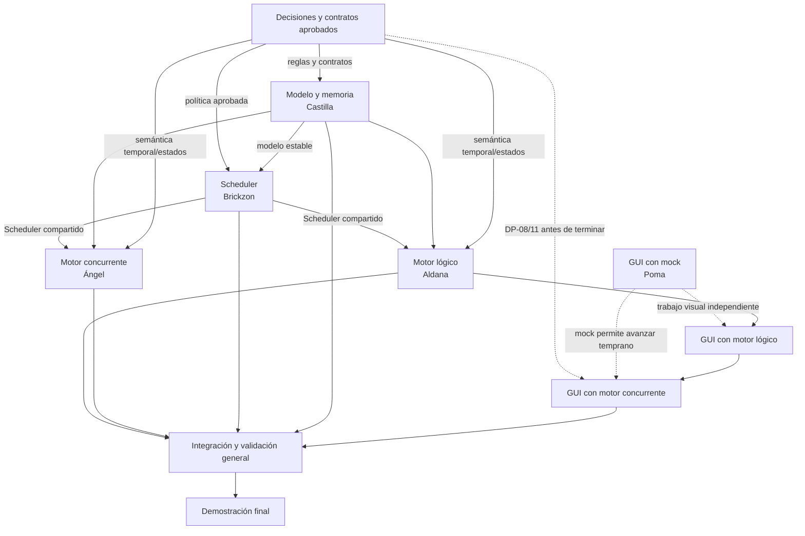

# Workflow de desarrollo de ConcurrentSimulator

> **Fase 0, formalizada 2026-10-15:** DP-01–DP-11 constan aprobadas; la fecha exacta de aprobación original no se informó. Los encabezados de `contracts/v2/` son candidatos, no operativos. No se migran módulos en esta rama documental. La fase posterior sigue [MIGRACION_CONTRATOS_V2.md](MIGRACION_CONTRATOS_V2.md): Castilla modelo/lista/memoria → Brickzon Scheduler; Aldana y Ángel en paralelo después de ratificar API/Scheduler; Poma avanza con mock. Gate G1 debe ratificar política de errores, driver continuo, checkpoints de cancelación y protocolo de eventos descritos en [Propuestas técnicas v2](PROPUESTAS_TECNICAS_V2.md); luego G2 modelo; G3 Scheduler; G4 equivalencia; G5 GUI/reproducción; G6 revisión integrada. En la matriz y descripciones históricas, quantum global y aging se refieren solo a v1.

Las descripciones detalladas heredadas más abajo preservan cómo se preparó la línea v1 y la auditoría de ramas. Cuando mencionan alternativas abiertas, aging operativo o quantum de 500 ms, se refieren a v1/antecedentes; el plan de migración v2 y el resultado de Fase 0 arriba tienen precedencia para el trabajo futuro.

Este documento es la referencia del equipo para ordenar el trabajo desde la línea base actual hasta una aplicación integrada. Formaliza responsables, dependencias, actividades paralelas y gates. DP-01–DP-11 están cerradas para el destino v2; las propuestas técnicas/API siguen separadas y requieren ratificación antes de adoptar contratos.

## Principios y estado de la línea base

- Los contratos v1.0 de `contracts/` y sus encabezados gobiernan las interfaces actuales. Un cambio compartido requiere decisión, versionado y migración coordinada.
- Las etiquetas `CONFIRMADO_POR_DOCENTE`, `PROPUESTA_DOCENTE`, `DECISION_EQUIPO` y `PENDIENTE_CONFIRMACION` conservan su significado en [requisitos docentes](REQUISITOS_DOCENTE.md), [especificación funcional](ESPECIFICACION_FUNCIONAL.md) y [decisiones pendientes](DECISIONES_PENDIENTES.md).
- Las ramas asignadas son `castilla`, `brickzon`, `aldana`, `angel` y `poma`. Identifican espacios de trabajo, no cuentas personales.
- Estado observado al preparar este workflow: PR #1 está fusionado en `master` y su línea base es `8f5b16b12c4012a97df7cacfabe8ed38c22eb318`. Modelo, cola, memoria y pruebas base están integrados. En `brickzon` existen Scheduler y archivos de pruebas; no están integrados en `master`. En `angel` existen motor concurrente, Scheduler y archivos de pruebas; no están integrados. En las ramas inspeccionadas no aparecen implementación del motor lógico ni de GUI. La existencia de archivos no demuestra que estén probados ni aprobados.
- No se encontró configuración de CI en `.github/` en la línea base inspeccionada. CMake registra actualmente `test_proceso`, `test_cola`, `test_memoria` y `test_integracion`; las ramas de Scheduler y concurrente tienen archivos de prueba adicionales, pero sus resultados no se presumen. Hasta que el equipo incorpore CI, cada PR debe aportar resultados reproducibles de validación local y los checks de GitHub se describen como no configurados, no como aprobaciones obligatorias.

## Matriz de fases

| Fase | Responsable | Dependencias | Entregables | ¿Paralelizable? | Gate de integración |
|---|---|---|---|---|---|
| 0. Decisiones funcionales y contratos | Coordinación del equipo | Evidencia, v1.0, especificación y casos | Cerrada: DP-01–DP-11, casos y API v2 candidata | Cerrada en Fase 0 | Decisiones aprobadas; propuestas técnicas separadas; adopción API ratificada antes de migrar |
| 1. Modelo, estructuras y memoria | Castilla (`castilla`) | API v2 ratificada | Modelo, validación, cuota derivada, lista simple, memoria y pruebas | Base de Scheduler; otros pueden preparar mock | API pública compatible; ownership/copia/move y límites validados; integrar por PR |
| 2. Scheduler | Brickzon (`brickzon`) | Modelo v2 estable | Clasificación dinámica, selección READY prioridad/ticket/PID, Round Robin y pruebas (sin aging) | Auditoría paralela con fase 1; migración depende del modelo | Una regla común; vectores y fronteras aprobados; reingreso asigna ticket nuevo |
| 3A. Motor lógico | Aldana (`aldana`) | Contrato y Scheduler v2 estables | Cuotas, reloj, eventos, WAIT/idle, paso, cancelación, timeline y pruebas | En paralelo con 3B; GUI puede avanzar con mock | Traza por paso determinista equivalente; sin wall-clock como reloj simulado |
| 3B. Motor concurrente | Ángel (`angel`) | Contrato y Scheduler v2 estables | CPU lógico único, cuotas/tickets, workers, sincronización, cancelación, snapshots y pruebas | En paralelo con 3A | Seguridad de concurrencia y equivalencia observable con 3A |
| 4. GUI y visualización | Poma (`poma`) | Interfaz común y `EstadoSistema` v2 ratificados para migración; mock disponible | Ventana, tabla, cola, CPU, temporizador visual, mapa conceptual de memoria, timeline, log, diálogo de alta y controles | Sí, puede iniciar desde fases 1–3 con mock/fixtures. Integración real primero con 3A, luego 3B | Qt 6 y ambos motores ya aprobados; vistas usan interfaz común, actualización segura en hilo UI, snapshots coherentes y pruebas/escenarios ejecutados |
| 5. Integración y validación general | Todos; Poma coordina integración visual | Módulos con gates anteriores y dependencias disponibles en `master` o mecanismo de integración acordado | Integración de módulos, casos de referencia, comparación de motores, validación del sistema | Solo las correcciones independientes; secuencia de integración sigue modelo → Scheduler → motores → GUI | Build, pruebas aplicables, casos y comparación aprobados; sin conflictos ni contratos incompatibles. Crear un PR no satisface el gate |
| 6. Demostración final | Todos | Fase 5 aprobada y decisiones efectivamente acordadas | Guion reproducible, datos de entrada y evidencia de ejecución | Preparación del guion puede ir en paralelo con integración; ejecución final depende de Fase 5 | Demostrar altas, prioridades, empate/rotación, llegada dinámica, memoria, WAIT/retorno, cancelación, turnos, timeline y ambos motores si siguen en alcance; sin resultados simulados o hardcodeados presentados como ejecución real |

Los nombres de archivo en asignaciones describen entregables previstos salvo que el estado anterior indique su presencia. Usa estas distinciones en cada PR: **documentado** (se especifica), **existente** (el archivo está en una rama), **implementado** (hay comportamiento en código), **probado** (una ejecución reproducible pasó) e **integrado** (está en la línea base acordada). No infieras un estado del otro.

## Dependencias y paralelismo



Las flechas sólidas expresan dependencia para integración o validación. Las punteadas indican trabajo visual que puede iniciarse con mocks o una decisión que debe cerrarse antes de completar GUI. 3A y 3B pueden desarrollarse en paralelo después de acordar las reglas compartidas; ninguno debe reimplementar la política del Scheduler.

## Fase 0 — Decisiones funcionales cerradas

Fase 0 está cerrada: DP-01–DP-11 se formalizaron el 2026-10-15; la fecha original de aprobación no está informada. No son decisiones pendientes. El registro de deliberación en [DECISIONES_PENDIENTES.md](DECISIONES_PENDIENTES.md) es histórico. Antes de migrar se ratifican únicamente las propuestas técnicas/API señaladas en [DECISIONES_APROBADAS.md](DECISIONES_APROBADAS.md#propuestas-técnicas-no-ratificadas). Para v2 rigen prioridad automática P1–P3, cuota derivada 10/20/30 ms, sin quantum global configurable, sin aging, paso por turno o avance idle hasta despertar, Qt 6 y dos motores con interfaz común.

Para cada decisión: analizar fuente académica y su etiqueta; comparar alternativas; localizar contratos y módulos afectados; acordar una opción; registrar decisión, fuente y alcance; actualizar especificación y casos de referencia; y solo entonces autorizar implementación. Si se requiere cambiar la API congelada, preparar nueva versión y migración coordinada. El criterio de salida es que cada módulo sepa qué puede implementar y qué permanece bloqueado; tareas independientes continúan.

## Fase 1 — Modelo, estructuras de datos y memoria

Responsable: **Castilla**, rama `castilla`. Revisar primero lo integrado en `master`: `contracts/`, `core/ColaProcesos.*`, `core/Memoria.*` y pruebas base. El modelo, cola, memoria y pruebas ya existen en la línea base inspeccionada; la asignación consiste en auditar y completar faltantes, no rehacer lo ya integrado.

Verificar semántica de altas, búsqueda, eliminación y filtros de `ColaProcesos`; validación, admisión, capacidad insuficiente y liberación de memoria; y compatibilidad con contratos. Resolver DP-09 antes de reemplazar la estructura implementada. Los archivos de prueba base registrados por CMake son `tests/test_proceso.cpp`, `tests/test_cola.cpp`, `tests/test_memoria.cpp` y `tests/test_integracion.cpp`.

**Gate:** faltantes delimitados y completados, comportamiento validado con pruebas ejecutadas, documentación/API consistente e integración aceptada. La existencia de archivos en `master` no declara el trabajo probado por esta fase.

## Fase 2 — Scheduler

Responsable: **Brickzon**, rama `brickzon`. Auditar la implementación y pruebas ya presentes en esa rama antes de cambiarla. Entregables previstos: `scheduler/Scheduler.h`, `scheduler/Scheduler.cpp`, `scheduler/SchedulerConfig.h`, `tests/test_scheduler_prioridad.cpp` y `tests/test_scheduler_empate.cpp`. `tests/test_scheduler_aging.cpp` es heredada v1; conservarla durante compatibilidad, sin implementar aging v2.

El Scheduler selecciona READY por prioridad descendente, ticket ascendente y PID ascendente; hay una regla compartida, sin aging. La prioridad determina la cuota vigente con `cuotaMs(prioridad)`. El motor fija una copia al despachar y asigna ticket nuevo al reingreso por WAIT o fin de cuota. El Scheduler no crea workers, temporizadores visuales ni interfaz gráfica. Los nombres de prueba heredados no convierten políticas v1 en trabajo pendiente v2.

**Gate:** selección determinista y pruebas/casos de referencia ejecutados y revisados; dependencias contractuales disponibles en `master` o integración coordinada documentada.

<a id="fase-3--motores-de-ejecucion"></a>
## Fase 3 — Motores de ejecución

Los dos frentes comparten contratos, Scheduler, reloj lógico y semántica aprobada. Su desarrollo puede ser paralelo, pero deben converger en los mismos casos observables. La regla del proyecto es un solo CPU lógico, aunque el motor concurrente use varios hilos del sistema.

### Fase 3A — Motor lógico

Responsable: **Aldana**, rama `aldana`. Crear `simulation/SimulationEngine.h/.cpp` y `simulation/SimulationClock.h/.cpp`. Implementar motor lógico sin threads reales, reloj en milisegundos simulados, estados, cuotas máximas 10/20/30 derivadas de prioridad, WAIT/retorno, finalización, cancelación, eventos y timeline de CPU ejecutado (PID positivo; idle inferido como gaps).

Pruebas previstas: `tests/test_simulation_quantum.cpp` (nombre heredado; validar cuota/turno v2, sin quantum global), `test_simulation_wait.cpp`, `test_simulation_finish.cpp`, `test_simulation_cancel.cpp` y `test_simulation_dynamic_process.cpp`. Cubrir intervalos/CPU restante; bloqueo y espera E/S; terminación y liberación; cancelación según semántica que se ratifique; y alta dinámica con snapshot/rechazo de memoria. Un paso en PAUSADO es una ráfaga hasta cuota/WAIT/FINISH/CANCEL o, sin READY y con WAIT, avance idle al despertar próximo sin despacho en esa llamada. Para modo continuo sin bloquear Qt, aplicar solo un driver técnico ratificado; DP-07 no define esa superficie de API.

**Gate:** motor determinista, snapshots/eventos/timeline coherentes, pruebas ejecutadas, semántica de paso acordada y resultados contrastables con casos aprobados. No introduce otro Scheduler.

### Fase 3B — Motor concurrente

Responsable: **Ángel**, rama `angel`. Auditar primero código ya existente en `angel`; existen archivos de motor concurrente y pruebas en esa rama, aún no integrados en `master`. Entregables: `concurrent/ConcurrentEngine.h/.cpp`, `ProcessThread.h/.cpp`, `Synchronization.h` y `tests/test_concurrent_basic.cpp`, `test_concurrent_pause.cpp`, `test_concurrent_cancel.cpp`, `test_concurrent_thread_shutdown.cpp`, `test_concurrent_race_safety.cpp`.

Un coordinador consulta al Scheduler y otorga un turno con cuota fijada desde prioridad. Los workers esperan permiso con `std::condition_variable`, ejecutan ráfaga autorizada y reportan resultado. Proteger snapshots, procesos, memoria, eventos y timeline; evitar busy waiting y mutex durante esperas. Implementar pausa/reanudación, el paso por turno o avance idle, cancelación, reinicio, cierre y `join()` de cada thread. Las pruebas cubren alta/validación/cuota/memoria, pausa, cancelación, destrucción/reinicio y acceso concurrente a snapshots/productor.

Comprobar orden de reingreso/Round Robin, ausencia de aging, WAIT/idle, cancelación según semántica ratificada, carreras, deadlocks y cierre de workers. El reloj lógico avanza por CPU simulada o por el paso idle aprobado; intervalos reales de coordinación no son cuota. No actualizar widgets desde workers.

**Gate:** pruebas concurrentes ejecutadas, terminación sin deadlocks/threads huérfanos, un único CPU lógico y equivalencia con el motor lógico en casos aprobados. La rama contiene archivos, pero no se afirma aquí ningún PASS.

<a id="fase-4--gui-y-visualizacion"></a>
## Fase 4 — GUI y visualización

Responsable: **Poma**, rama `poma`. GUI aún no aparecía implementada en las ramas inspeccionadas. Puede avanzar desde temprano con un mock y snapshots de `EstadoSistema`, sin esperar al fin de motores. Las rutas propuestas son `gui/MainWindow.*`, `ProcessTable.*`, `QueueWidget.*`, `CPUWidget.*`, `MemoryWidget.*`, `TimelineWidget.*`, `EventLogWidget.*`, `NewProcessDialog.*` y `main.cpp`; coordinar cualquier cambio de CMake fuera de esta documentación.

Construir selector de los dos motores y controles de velocidad visual, alta, inicio/pausa/paso/reinicio; tabla, cola READY, CPU, mapa conceptual de memoria, timeline y log. No incluir control global de quantum, aging ni prioridad manual. El diálogo acepta nombre, tamaño, tiempo de CPU y E/S opcional; la prioridad se clasifica automáticamente. Mockear la interfaz común y fixtures para READY, RUN parcial, fin de cuota, WAIT/idle, reanudación, FINISH/CANCEL y memoria. Mantener todas las reglas de scheduling fuera de widgets.

La GUI consume `IExecutionEngine` común y `EstadoSistema`; integrar primero motor lógico y después concurrente. Proyecto aprobado con Qt 6. Las actualizaciones originadas en worker llegan de forma segura al hilo principal. El refresco no modifica tiempo simulado. Timeline muestra solo segmentos `[inicio,fin)` de CPU real con PID positivo e infiere huecos idle desde el origen hasta el reloj snapshot. Memoria muestra ocupantes y espacio libre, sin direcciones físicas. El selector permite ambos motores.

La asignación original no fija nombres obligatorios para tests GUI; tratar estos como escenarios de integración y escoger el mecanismo con el equipo: renderizar snapshots equivalentes del mock y motores; alta válida/rechazo de memoria; cancelación y PID inexistente; pausa/paso/reinicio; RUN transitorio; seguridad del hilo UI; orden y proporción del timeline; mapa conceptual; y velocidad visual independiente del reloj.

**Gate:** aplicación interactiva integrada con ambos motores, actualización UI segura y escenarios reproducibles. Qt 6, timeline y motores compartidos ya están aprobados; propuestas de API aún requieren ratificación.

## Fase 5 — Integración y validación general

Participan los cinco responsables; Poma coordina integración visual sin modificar unilateralmente módulos ajenos. Orden de integración recomendado: modelo/memoria → Scheduler → motor lógico → motor concurrente → GUI; integrar primero el motor lógico en GUI y luego el concurrente. Antes de integrar una dependencia, confirmar que está en `master` o acordar/documentar integración coordinada entre ramas. Comparar ambos motores con las mismas entradas, decisiones y criterio de paso.

La línea base dispone de CMake 3.20+, C++17 y CTest. Cuando se implementen cambios, el PR debe ejecutar configuración, build y pruebas aplicables, por ejemplo:

```powershell
cmake -S . -B build -DBUILD_TESTING=ON
cmake --build build --config Debug
ctest --test-dir build -C Debug --output-on-failure
```

Esas instrucciones no son resultados de pruebas de este workflow. Si hay pruebas específicas de motores/GUI, documentar comando, configuración, entorno y resultado. Al no haber CI detectado en la línea base, marcar automatización como pendiente hasta que se añada; no inventar checks obligatorios. **No fusionar** mientras existan pruebas fallidas, conflictos sin resolver o contratos incompatibles. El gate se satisface con validación ejecutada y revisada, dependencias disponibles y casos acordados cubiertos; que exista un PR no basta.

## Fase 6 — Demostración

Preparar entradas y pasos reproducibles para alta de procesos, prioridad, empate y rotación, llegada dinámica, carga/rechazo/liberación de memoria, WAIT/retorno, cancelación, ejecución por turnos, timeline y comparación de motores si ambos permanecen en alcance. Explicar la política realmente aprobada. Guardar evidencia adecuada y no presentar mocks, snapshots inventados o datos hardcodeados como ejecución real.

## Workflow de Git y Pull Requests

Para cada cambio de implementación o documentación del equipo:

1. Consultar estado y actualizar referencias remotas (`git fetch origin`); inspeccionar `origin/master` y cambios ya fusionados.
2. Sincronizar la rama propia con cuidado, verificando commits y cambios locales primero. Elegir merge/rebase según coordinación de la rama; no imponer rebase ni force-push en ramas compartidas.
3. Leer asignación, contratos, especificación, casos y decisiones aprobadas pertinentes.
4. Limitarse al módulo y reglas autorizados; coordinar cambios transversales antes de editar interfaces compartidas.
5. Añadir/actualizar pruebas y ejecutar validaciones relevantes; reportar solo resultados realmente observados.
6. Revisar diff, archivos tocados, compatibilidad, conflictos, enlaces/documentación y estado de las decisiones.
7. Crear commits descriptivos y publicar la rama.
8. Abrir PR hacia `master`, declarar dependencias y solicitar revisión.
9. Revisar CI disponible, conflictos y compatibilidad con las dependencias; si no hay CI, reportar validación local y automatización pendiente.
10. Fusionar solo tras revisión/aprobación, gates satisfechos y dependencias integrables. No fusionar con fallos, conflictos pendientes ni interfaces incompatibles.

Cada PR de implementación informa responsable/módulo, issue si existe, requisitos, decisiones aplicadas, archivos, dependencias, pruebas y resultados, capturas/demo cuando apliquen, limitaciones y confirmación de aprobación para cualquier cambio contractual. En un cambio transversal, registrar propuesta, responsables revisores, impacto contractual, versión/migración e integración de módulos afectados. No asumir cambios de API por comentario informal.

## Decisiones que pueden bloquear trabajo

DP-01–DP-11 ya no bloquean por falta de decisión funcional. La migración espera ratificación de las propuestas técnicas/API v2 y sigue los gates G1–G6 de [MIGRACION_CONTRATOS_V2.md](MIGRACION_CONTRATOS_V2.md). El trabajo independiente avanza en paralelo con contratos estables y mocks.

## Fuentes y validación documental

Este workflow enlaza la [especificación funcional](ESPECIFICACION_FUNCIONAL.md), [decisiones pendientes](DECISIONES_PENDIENTES.md), [casos de referencia](CASOS_REFERENCIA.md), [matriz de trazabilidad](MATRIZ_TRAZABILIDAD.md), [contratos v1.0](../contracts/README.md), las cinco asignaciones individuales y las [reglas para agentes](../AGENTS.md). Las reglas académicas se consultan en [REQUISITOS_DOCENTE.md](REQUISITOS_DOCENTE.md); no se publican los documentos fuente.
